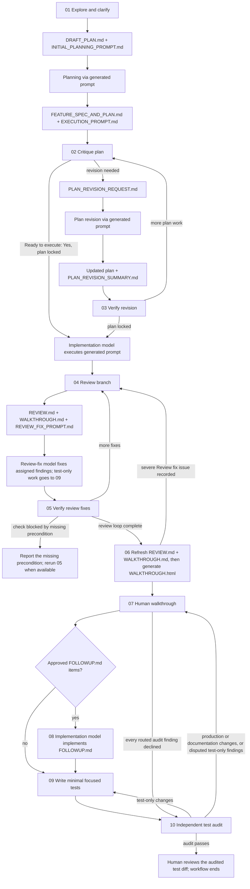

# AI Coding Workflow

A phase-based prompt pack for moving a coding task from clarification to planning, implementation, review, human approval, focused tests, and an independent test audit.

Use this repository as the workflow source; make application changes in the target repository. Copy each checked-in prompt into a fresh model session with the target code repository open. Runtime artifacts such as `DRAFT_PLAN.md`, `FEATURE_SPEC_AND_PLAN.md`, `REVIEW.md`, `WALKTHROUGH.html`, and `TEST_AUDIT.md` belong in the target repository root.

## Workflow



Generated prompt artifacts are the only prompt input for their handoff:

- `INITIAL_PLANNING_PROMPT.md` drives the main planning pass.
- `PLAN_REVISION_REQUEST.md` drives a plan-revision pass.
- `EXECUTION_PROMPT.md` drives locked implementation.
- `REVIEW_FIX_PROMPT.md` drives a review-fix pass.

If a generated prompt is incomplete, return to its producer phase instead of inventing a parallel checked-in prompt.

## Prompt Index

| Step | Prompt | Model / role | Result |
|---|---|---|---|
| 01 | [Initial exploration](prompts/01_initial_exploration_any_model.md) | Any capable repo-aware model | `DRAFT_PLAN.md`, `INITIAL_PLANNING_PROMPT.md` |
| 02 | [Plan critique](prompts/02_plan_critique_any_model.md) | Any capable repo-aware model | `PLAN_CRITIQUE.md`; `PLAN_REVISION_REQUEST.md` only when `Ready to execute` is `No` or the human asks to address non-blocking issues |
| 03 | [Plan-revision verification](prompts/03_plan_revision_verification_any_model.md) | Any capable repo-aware model | `PLAN_REVISION_VERIFICATION.md` |
| 04 | [Implemented-branch review](prompts/04_review_branch_any_model.md) | Any capable repo-aware model | `REVIEW.md`, `WALKTHROUGH.md`, `REVIEW_FIX_PROMPT.md` |
| 05 | [Review-fix verification](prompts/05_verify_review_fixes_any_model.md) | Any capable repo-aware model | `REVIEW_FIX_VERIFICATION.md` |
| 06 | [Final review-artifact refresh](prompts/06_refresh_review_and_walkthrough_any_model.md) | Any capable repo-aware model | Refreshed `REVIEW.md` and `WALKTHROUGH.md`, then interactive `WALKTHROUGH.html` |
| 07 | [Human code walkthrough](prompts/07_human_code_walkthrough.md) | Any capable repo-aware model with a human | Human-approved `FOLLOWUP.md`, when needed, including declined audit findings |
| 08 | [Human follow-up implementation](prompts/08_implement_human_followup_any_model.md) | Any capable repo-aware model | Unchecked approved follow-up changes, with per-item evidence in `FOLLOWUP.md` |
| 09 | [Focused test writing](prompts/09_write_focused_tests_any_model.md) | Any capable repo-aware model | Test-file changes only, followed by phase-10 audit |
| 10 | [Independent test audit](prompts/10_test_audit_any_model.md) | Any capable repo-aware agent | `TEST_AUDIT.md`, followed by human review after approval |

The main planning pass, plan-revision pass, locked implementation pass, and review-fix pass use generated prompts, so they do not have separate checked-in phase files.

## Optional Independent Phases

These phases run only when explicitly requested. Their numbers identify standalone prompts; they are not steps after `10`, prerequisites for the main workflow, or substitutes for its approval gates. The main workflow still ends with human review of the audited test diff.

| Phase | Prompt | Model / role | Result |
|---|---|---|---|
| 11 | [Repository complexity audit](prompts/11_optional_complexity_audit_any_model.md) | Any capable repo-aware agent | Read-only findings in chat; no file or Git changes |
| 12 | [UI prototyping](prompts/12_optional_ui_prototyping_any_model.md) | Any capable repo-aware model with a human | Isolated previews under `.ui-prototypes/<slug>/` and `UI_PROTOTYPE.md`; explicit human selection before planning |

Use `11` to inspect repository complexity, including backend code. It uses `ponytail-audit` and its `ponytail-review` companion, ranks supported findings by maintenance benefit and risk, and checks callers and contracts before recommending deletion. Select findings before taking them to `01`; an active human walkthrough still requires `AGREE` and the final go-ahead for follow-up work.

Use `12` when choosing between UI directions before locking a plan. It uses `prototype`, its required `PICKER.md`, and `emil-design-eng` for isolated web UI variants. It creates no production changes, tests, dependencies, commits, or pull requests. A native UI request needs a compatible approach agreed before construction. A selected variant and `UI_PROTOTYPE.md` become context for `01`; selection does not authorize production integration. Keep previews available through selection and plan their cleanup explicitly.

## How to Run It

1. Open the target code repository in a repo-aware agent UI. Keep this prompt pack available only as the instruction source.
2. Run [prompt 01](prompts/01_initial_exploration_any_model.md) with the task. It creates `DRAFT_PLAN.md` and `INITIAL_PLANNING_PROMPT.md`.
3. Paste `INITIAL_PLANNING_PROMPT.md` into any capable repository-aware model or agent. Save the resulting `FEATURE_SPEC_AND_PLAN.md` and `EXECUTION_PROMPT.md`.
4. Run [prompt 02](prompts/02_plan_critique_any_model.md). If it sets `Ready to execute: No`, paste its generated `PLAN_REVISION_REQUEST.md` into any capable repository-aware model or agent. If it sets `Ready to execute: Yes`, the plan is locked: skip `03` and go to step 6.
5. After a plan revision pass, run [prompt 03](prompts/03_plan_revision_verification_any_model.md). It stops without a verdict when no revision pass ran. Repeat `02 -> plan revision -> 03` until the plan is locked. On each repeat, `02` and the revision pass read `PLAN_REVISION_VERIFICATION.md` and carry its unresolved items forward.
6. Paste `EXECUTION_PROMPT.md` into any capable repository-aware coding model to implement `FEATURE_SPEC_AND_PLAN.md`.
7. Run [prompt 04](prompts/04_review_branch_any_model.md). Paste its generated `REVIEW_FIX_PROMPT.md` into any capable repository-aware coding model when review fixes are needed, then run [prompt 05](prompts/05_verify_review_fixes_any_model.md). Repeat until all findings assigned to `Review fix` are resolved; when `04` reports none unresolved, go straight to step 8. Run `04` and `05` in a fresh session or agent. Implementation and review-fix passes record intended existing-test breaks in the pull-request description so those fresh sessions can read them. Carry test-only findings marked `Deferred to 09` to phase 09. When `05` reports that a required check cannot run only because an environment, credential, or access precondition is unavailable, supply that precondition and rerun `05` instead of returning to `04`.
8. Run [prompt 06](prompts/06_refresh_review_and_walkthrough_any_model.md) to refresh `REVIEW.md` and `WALKTHROUGH.md`, then generate and browser-check `WALKTHROUGH.html`. If `06` records a severe missed issue assigned to `Review fix` in `REVIEW.md`, it skips `WALKTHROUGH.html` and the workflow returns to `04` for the next `REVIEW_FIX_PROMPT.md`. Use [prompt 07](prompts/07_human_code_walkthrough.md) for independent human review. Start with a brief prose overview of the code; explain success/error flows alongside small semantic blocks using focused diffs, pseudocode for material logic changes, and excerpts for referenced declarations and definitions. Keep presentation diffs and pseudocode in chat only; `WALKTHROUGH.md` retains source excerpts and prose context. The HTML is supplemental context and does not replace current-code review. Approve follow-up items with `AGREE`. After `RESOLVE`, the model rechecks the file and verifies it is marked Viewed on the PR through `gh` before advancing; failures keep completion pending.
9. If the human approves follow-up work, record it in `FOLLOWUP.md` and run [prompt 08](prompts/08_implement_human_followup_any_model.md). It implements only unchecked implementation items, records evidence under each completed item, leaves test-authoring items for `09`, and makes no commit when nothing remains. If the walkthrough agrees no item, `07` creates no `FOLLOWUP.md` and the workflow skips to step 10.
10. Run [prompt 09](prompts/09_write_focused_tests_any_model.md) against the final branch state. It treats unchecked `FOLLOWUP.md` test-authoring items as required test work.
11. Run [prompt 10](prompts/10_test_audit_any_model.md) with any capable repository-aware agent, and give it phase `09`'s chat handoff. If it reports test-only findings, return to `09`, then repeat `10`. Route findings that require production or documentation changes back to [prompt 07](prompts/07_human_code_walkthrough.md), where only `AGREE`d corrections enter `FOLLOWUP.md` for `08`, before repeating `09` and `10`. Test-only findings that `09` reported as unsupported with evidence and that `10` still holds also go to `07` for a human decision. `07` records findings the human explicitly declines under `## Declined Audit Findings` in `FOLLOWUP.md`; when every routed finding is declined, skip `08` and `09` and run the next `10` pass. Audit findings keep stable identifiers and statuses across passes.
12. Human-review the audited test diff after phase `10` passes.

You may also start directly at [prompt 04](prompts/04_review_branch_any_model.md) for an existing implementation branch. Earlier planning and execution artifacts are optional: when absent, the reviewing model reviews the branch against `main` and repository evidence; when present, it also treats them as authoritative review context.

Use a fresh chat for each major phase or model handoff. Use artifact files for handoffs; do not depend on hidden chat history.

## Operator Rules

- Run the workflow in the target code repository, never in this prompt-pack repository.
- Store every workflow-generated Markdown artifact and `WALKTHROUGH.html` in the target repository root under its exact required filename.
- Give each generated artifact `Created by`, `Created at`, and `Updated at` fields. Preserve the creation fields and refresh `Updated at` on edits.
- Treat the implementation-plan section of `FEATURE_SPEC_AND_PLAN.md` as the execution contract and its spec/reference section as context.
- Use the checked-in prompt for checked-in phases and the generated artifact for generated phases.
- Do not stage or commit workflow-generated artifacts, including `WALKTHROUGH.html`, `UI_PROTOTYPE.md`, and files under `.ui-prototypes/`, unless explicitly requested.
- Execution phases verify their work, stage intended source/test changes, create focused commits, push the current branch, and create a pull request only when that branch does not already have one. GitHub CLI (`gh`) is the fallback for checking PR existence.
- Documentation is a required checkpoint, not final cleanup: at every planning, implementation, review, verification, and human-handoff stage, record either the exact durable documentation updated and its validation evidence or an evidence-based `Not applicable` decision. Implementation and fix stages complete applicable documentation in the same change set. Phases `09` and `10` verify this status but cannot edit documentation.
- Stop and ask when required decisions, repository facts, or instructions conflict. Do not fill material gaps with assumptions.

## Artifact Chain

| Artifact | Producer | Main consumer |
|---|---|---|
| `DRAFT_PLAN.md` | 01 | Generated planning prompt |
| `INITIAL_PLANNING_PROMPT.md` | 01 | Main planning pass |
| `FEATURE_SPEC_AND_PLAN.md` | Planning/revision pass | Critique, execution, and review phases |
| `EXECUTION_PROMPT.md` | Planning/revision pass | Locked implementation |
| `PLAN_CRITIQUE.md` | 02 | Plan revision and 03 |
| `PLAN_REVISION_REQUEST.md` | 02, only when revision is needed | Plan revision |
| `PLAN_REVISION_SUMMARY.md` | Plan revision, including the previous and revised wording of changed `EXECUTION_PROMPT.md` instructions | 03; 02 and the next plan revision on another pass |
| `PLAN_REVISION_VERIFICATION.md` | 03, only after a revision pass | Execution gate; 02 and the next plan revision when issues remain |
| `REVIEW.md` | 04, refreshed by 06; 06 also records severe missed issues | Review-fix context, 05, 04 on its next pass, and later workflow context |
| `WALKTHROUGH.md` | 04, refreshed by 06 | Review-fix and human walkthrough context |
| `WALKTHROUGH.html` | 06, after refreshing both Markdown files | Interactive mental model for the human reviewer; supplemental context only |
| `REVIEW_FIX_PROMPT.md` | 04 | Review-fix pass |
| `REVIEW_FIX_VERIFICATION.md` | 05 | 06; 04 on its next pass, which adopts recorded new issues |
| `FOLLOWUP.md` | 07; 08 adds per-item evidence | 08; 09 and 10 |
| `TEST_AUDIT.md` | 10 | Human reviewer; 09 for test-only findings; 07 for production or documentation findings and disputed test-only findings; 08 for items that cite a finding; 10 on the next audit pass |
| `UI_PROTOTYPE.md` | Optional 12 | Human selection; 01 when planning is requested |

Prompt 09 changes test files only. It must not create another prompt, review, walkthrough, plan, summary, or workflow Markdown artifact, and it must not leave generated coverage output in the repository. Prompt 10 then performs a read-only audit, writes only `TEST_AUDIT.md`, and routes supported findings to the correct earlier phase. Human review of the audited test diff ends the workflow after phase 10 passes.

## Core Design

- One prompt input per phase. A generated downstream prompt replaces a separate checked-in prompt for that handoff.
- Prompts are self-contained. Repeated skill and Engineering Contract blocks are intentional.
- Main implementation, review fixes, and human follow-up receive the same applicable engineering requirements used in review. Generated execution and fix prompts are checked for complete contracts before handoff; planning critique and verification block incomplete execution prompts.
- No skill router. Each prompt lists only the supporting skills relevant to its phase, and the prompt always wins over a skill.
- The default planning output is one combined `FEATURE_SPEC_AND_PLAN.md` plus a separate `EXECUTION_PROMPT.md`. Separate `SPEC.md` and `IMPLEMENTATION_PLAN.md` files are fallback-only.
- Every phase, including generated-prompt passes, accepts any capable repository-aware model or agent. Phases 04 and 05 must run in a fresh session or agent without the implementation or review-fix context.
- Planning and AI review each have a verification loop. Human review remains an independent approval gate.
- Phase 09 adds the smallest meaningful focused test set. The final automated phase independently audits those tests before human review.

Prompt maintenance must preserve every requirement, checklist item, evidence field, example, exception, condition, skill dependency, and phase boundary. Keep intentionally repeated contracts complete in each copy-paste-ready prompt. Wording cleanup must not replace detailed requirements with summaries or references to another prompt. Check the actual generated planning, revision, execution, and review-fix prompts against their complete source contracts before handoff.

## Simplicity and Reuse

Every phase applies a simplicity and reuse procedure to backend and UI work within its existing permissions:

- inspect existing code, standard-library capabilities, native platform features, and installed dependencies before proposing custom code,
- before adding new behavior, trace how the repository already handles comparable behavior and build on its established components, shared services, and extension points instead of a parallel flow; stop and ask when the approved scope appears to need one,
- explicitly review duplication, excess abstractions, unused paths, and avoidable complexity; justify abstractions and dependencies by current requirements or necessary ownership boundaries,
- trace relevant callers before choosing a bug-fix location, search the codebase for the same failure pattern when a defect is found, and verify references and contracts before proposing deletion. Fix only approved occurrences and report others within the phase's existing output,
- preserve readability, compatibility, validation, security, and verification; fewer lines are not an acceptance criterion.

Phase 04 explicitly checks that new code fits and reuses the repository's existing architecture. It traces component responsibilities, dependency direction, shared services, and extension points, then flags unapproved parallel architecture or bypassed layers with concrete evidence. Valid fixes use the established paths and remain within the approved scope.

Architecture and other high-impact changes receive deeper scrutiny based on affected consumers and failure consequences, even for small diffs. Phase 04 traces the relevant contract, data, security, concurrency, and recovery risks and records the additional evidence gathered or still required. The generated fix prompt and phase 05 carry those risks into verification; phase 06 refreshes the evidence for the final revision.

These rules draw from [Ponytail](https://github.com/viseshrp/ai-skills-archive/blob/main/archives/DietrichGebert__ponytail/snapshot/skills/ponytail/SKILL.md) and [ponytail-review](https://github.com/viseshrp/ai-skills-archive/blob/main/archives/DietrichGebert__ponytail/snapshot/skills/ponytail-review/SKILL.md). The rules are embedded in the prompts; these provenance links do not activate either skill. Persistent modes, line-count scoring, production assertion demos, test quotas, debt markers, and separate ledgers are excluded. Existing scope, dependency approval, and test-phase boundaries still apply.

Deliberate simplifications with material limits must name why they meet current requirements, their known limit, and the evidence that would trigger revisiting them. Record these decisions in existing planning sections and carry applicable limits into durable documentation during authorized implementation. Review and audit phases verify them through the existing documentation checkpoint.

Reviews and handoffs must support latency, memory, or cost improvement claims with comparable before-and-after measurements. Identify the baseline, changed version, workload, method, and relevant environment; otherwise label the expected improvement `unmeasured`. This adapts [ponytail-gain's honesty boundary](https://github.com/viseshrp/ai-skills-archive/blob/main/archives/DietrichGebert__ponytail/snapshot/skills/ponytail-gain/SKILL.md); the provenance link does not activate the skill or its benchmark scoreboard. These rules add no comment markers, debt ledger, benchmark infrastructure, or workflow artifacts.

## Review Evidence and Original Intent

Planning establishes acceptance criteria and expected outcomes from product requirements, approved clarifications, and public contracts before choosing implementation details or test expectations. Re-read those sources after long sessions or handoffs to detect drift. Phase 04 independently develops scenarios that challenge completion claims and exercises changed runtime behavior through the running application and relevant real APIs, using existing tools in an authorized environment. Remote requests remain read-only unless their side effects are authorized. Passing author-written tests cannot excuse failed acceptance behavior or missing required runtime proof; changes with no runnable behavior receive an evidence-based `Not applicable` decision.

Review judges both the implementation and its tests against those independent criteria. If tests pass while real API checks fail, investigate the disagreement and keep completion pending until the required behavior is verified. Do not rewrite expectations to preserve a passing result. Missing access or an unavailable environment leaves required verification pending and prevents a passing verdict.

Report only actionable findings, ordered by severity, with a stable identifier, status (`Open`, `Partially Resolved`, `Resolved`, `Invalid Finding`, or `Deferred to 09`), destination phase, exact file/line evidence, affected requirement or contract, concrete impact, reproduction steps, and a correction or acceptance check. Static issues use repeatable inspection or call-trace steps; unexecuted scenarios are labeled `Not run`. Keep unanswered questions and pending checks separate from confirmed defects, and optional improvements in `Suggestions`. Empty issue or suggestion sections say `None.`

The first review covers the full branch; later passes review only changes since the recorded review or verification state and their affected paths. Carry unresolved findings and pending checks forward. Reuse evidence only when the relevant behavior, contracts, dependencies, configuration, and environment are unchanged; a test-only commit need not invalidate runtime evidence. Group occurrences with the same failure mechanism and corrective rule under one finding. Fix all confirmed occurrences within the approved scope, then verify the category is resolved. Never repost a finding: update its existing status and evidence, reference its identifier in handoffs, and preserve its history during phase 06 refresh. New issues recorded by phase 05 and severe missed issues recorded by phase 06 continue `REVIEW.md`'s identifier sequence, and phase 04 adopts them without reposting them; phase 06 adopts `Deferred to 09` new issues from phase 05 the same way.

Test-only findings, including missing integration tests or final coverage proof, are marked `Deferred to 09`. They do not block the earlier review handoff once all findings assigned to `Review fix`, required runtime checks, and documentation checkpoints pass. The overall result for whether all valid blocking and non-blocking findings are resolved remains `No` while any valid finding is deferred or unresolved; current-stage readiness is a separate result. Phase 09 addresses those identifiers using the fewest meaningful tests and verifies at least 85% changed-line coverage; phase 10 independently audits every disposition. This deferral cannot waive a production defect or failed acceptance behavior, and final test approval still requires phases 09 and 10.

Review records the challenged claims, independently derived scenarios, exact commands or interactions, expected and observed results, source revision and environment, pending checks, repeated-defect search scope and occurrences, and incident diagnostic evidence. Logging review asks whether an engineer could identify the failing operation, correlate a request or job, understand the cause and trace, and determine retry or recovery outcomes without exposing secrets or sensitive payloads or creating duplicate noise. Reviewers re-read original requirements after long sessions or handoffs to identify drift. Generated planning, revision, execution, and fix prompts carry the applicable requirements; verification, human follow-up, test writing, and test audit apply them within their existing permissions. Test authoring remains in phase 09, and broader defect discovery does not authorize broader fixes.

## Walkthrough Explanations and Interactive Model

Phases 04, 06, and 07 use ISO-style plain language and ASD-STE100-inspired technical writing without claiming formal compliance. Explanations use complete sentences, define terms and abbreviations, and explain symbols, background, and cause and effect without assuming prior chat or repository knowledge. Exact identifiers, source excerpts, and line-by-line coverage remain required, with `no-ai-slop` as the final writing guide.

After refreshing and verifying both Markdown files, phase 06 generates one self-contained `WALKTHROUGH.html`. It provides a navigable code map, component details, selectable success/error scenarios, and step controls connected to verified source locations. It opens locally without dependencies or network access, records the reviewed revision and browser verification status, and distinguishes observed behavior from code-derived explanations. Required browser verification stays pending when unavailable.

This HTML explains the changes; it does not execute the application or replace independent human review, `AGREE`, `RESOLVE`, or the final go-ahead. Only phase 06 generates or refreshes it. Later code changes can make it stale, so consumers check it against current code. Keep it uncommitted unless explicitly requested.

## UI Work Only

Phases `01` through `11` and generated downstream prompts have a separate `## UI work only` section. Enable it only when the task or reviewed change includes UI behavior, layout, presentation, or interaction. Backend-only work skips the section, including its skill downloads, questions, checks, and reporting. A backend service having UI consumers does not by itself enable it. Phase `12` is entirely UI prototyping: its skills and requirements apply directly, without a separate UI activation gate.

| Stage | UI requirements when applicable |
|---|---|
| 01 and generated planning | Resolve data and state cases, keyboard and touch behavior, motion purpose, acceptance checks, and documentation impact. |
| 02, generated revision, and 03 | Critique and verify those decisions and the complete conditional UI contract in the actual execution prompt. |
| Generated execution, review fixes, and 08 | Implement approved UI behavior with existing components and tokens; verify interactions using existing facilities and report required checks still pending. |
| 04 through 07 | Review changed behavior, verify accepted fixes, refresh evidence, and conduct independent human review under the existing approval gates. |
| 09 and 10 | Write and independently audit the smallest meaningful behavior tests; distinguish automated proof from visual or device checks. |

The conditional skill set comes from the archived [Emil Kowalski collection](https://github.com/viseshrp/ai-skills-archive/tree/main/archives/emilkowalski__skills/snapshot/skills):

- `emil-design-eng` for web UI design decisions and `animation-vocabulary` when a requested motion effect needs clarification,
- `break-ui` with `CATALOG.md` for applicable realistic data and state cases, using its analysis only,
- `animate` with `RECIPES.md` for web motion construction, with `pick-ui-library` only when that work requires selecting a UI primitive,
- `review-animations` with `STANDARDS.md` for changed web motion,
- `mobile-native` for mobile-web behavior.

Each prompt carries the full GitHub links for its applicable skills and companions. Web-specific guidance applies only to web UI. Existing design decisions and tokens take precedence over recipe values; aesthetic preferences do not become required fixes without evidence of a defect or contract mismatch. Verify version-sensitive APIs and performance claims against the target stack.

UI skills do not authorize prototypes, development toggles, extra reports, dependencies, or a new workflow phase. Phase 09 alone may author test-local fixtures. Keep UI evidence in existing artifacts or chat, and identify observed behavior, code-only conclusions, and required browser or device checks still pending. Preserve documentation checkpoints, `AGREE`, `RESOLVE`, and the final human approval gates.

The isolated preview and `UI_PROTOTYPE.md` in optional phase `12` are the only prototype exception. This exception applies only when that phase is explicitly requested; the other phases retain their existing UI restrictions. Prototype sample data stays local to the preview and does not authorize shared test fixtures. Optional phase `11` applies only the complexity evidence bar to UI code and adds no visual audit or UI skill downloads.

### Conditional Frontend Design

Alongside the UI skills above, [design-taste-frontend](https://github.com/viseshrp/ai-skills-archive/blob/main/archives/Leonxlnx__taste-skill/snapshot/skills/taste-skill/SKILL.md) supports landing or marketing pages, portfolios, editorial or brand pages, and explicitly approved visual redesigns of those surfaces. It excludes backend-only work, dashboards, admin or dense product interfaces, data tables, multi-step forms, native mobile UI, and general refactors. Mixed tasks apply it only to the eligible surface.

Its explicit link and gate live inside the existing `UI work only` sections of phases `01` through `06` and `08` and their generated planning, revision, execution, and review-fix prompts. In those phases, other UI work keeps its existing skill guidance and records `Frontend design: Not applicable`; backend-only work skips UI downloads and reporting entirely. Phases `07`, `09`, `10`, `11`, and `12` have no direct use of this skill.

| Stage | Frontend design responsibility |
|---|---|
| 01 and generated planning | Clarify the brief in `DRAFT_PLAN.md`, then lock `## Frontend Design Contract` inside `FEATURE_SPEC_AND_PLAN.md`. |
| 02, generated revision, and 03 | Critique, repair, and verify the contract and its enforcement in the actual `EXECUTION_PROMPT.md`. |
| Generated execution and review fixes; 04 | Implement the approved contract or accepted finding; review rendered UI against that baseline. Direct-entry review may use repository evidence when planning artifacts are absent. |
| 05 and 06 | Verify accepted fixes and refresh the final rendered evidence without reopening the design direction. |
| 08 | Apply the skill only to explicitly human-approved eligible `FOLLOWUP.md` items. |

The contract records the audience, visual direction and references, existing brand/assets/tokens, redesign mode, required design decisions, responsive/accessibility/state behavior, asset policy, protected content/SEO/routes/forms/analytics, approved dependencies, prohibited changes, and representative desktop/mobile verification. Keep locked requirements separate from optional aesthetic suggestions and record evidence or pending checks in existing artifacts and execution responses.

The user request, locked artifacts, existing design system, repository conventions, accessibility, and dependency approvals override skill defaults. Dials, font and palette bans, layout recipes, and motion preferences do not authorize dependencies, framework or design-system changes, assets, themes, content rewrites, or a broader redesign. Review findings need an objective defect or contract violation; a different aesthetic remains a suggestion.

`gpt-taste` is excluded. Specialized sibling skills such as `image-to-code`, `brandkit`, and `redesign-existing-projects` require explicit task-specific authorization and their own archive links. They are not loaded automatically.

## Documentation Checkpoints

Documentation follows the same gate discipline as code and verification:

- Planning phases identify the durable user-, operator-, API-, configuration-, and developer-facing documentation affected by every implementation step, or explain why none applies.
- Implementation, review-fix, and human-follow-up phases update and validate the affected documentation in the same change set before they mark the step complete.
- Critique, review, verification, refresh, and human-walkthrough phases check the result against the actual branch and record missing documentation as an issue or approved follow-up item.
- Phases 09 and 10 must verify that the prior documentation checkpoint passed and stop/escalate an unresolved gap instead of editing documentation. Phase 09 reports, without stopping on, a gap whose audit finding the human declined in `FOLLOWUP.md`.

Optional phase `11` identifies the documentation impact of proposed changes in chat without editing files. Optional phase `12` records the selected design's documentation impact, planned validation, or evidence-based `Not applicable` decision in `UI_PROTOTYPE.md`; durable documentation changes wait for authorized implementation.

## Testing Policy

Earlier phases may inspect or run focused tests, but they do not author tests. Prompt 09 owns the complete test-writing contract:

- tie each test's acceptance criterion and expected outcome to an independent product requirement, approved clarification, or public contract,
- use the smallest focused integration proof for material component or API interactions through actual public entry points; reuse sufficient existing coverage and add tests only for genuine gaps,
- write the fewest nonduplicative tests for uncovered changed behavior and material regression risks; a bug fix alone does not justify a new regression test,
- prefer extending existing tests and consolidating trivial tests of the same behavior when assertions and failure diagnostics stay clear,
- keep tests behavior-focused, deterministic, isolated, and small enough to read linearly; reject tautological or self-testing tests and change detectors that freeze implementation details without an observable contract,
- follow the repository's existing test-framework configuration and reuse its fixtures, native APIs, and installed extensions instead of hand-rolled test infrastructure,
- never patch or mock the subject under test itself; patch only impractical external collaborators and avoid implementation-detail assertions,
- reach at least 85% coverage for new or changed lines without weakening coverage configuration or adding coverage-only tests,
- change test files only, then hand the test diff to phase 10 without generating another prompt or workflow artifact.

Integration tests use existing isolated facilities and native framework APIs, and must exercise the boundary they claim to verify. Keep automated tests independent of live external services; checks against running applications and real APIs remain separate verification evidence. An unresolved acceptance failure or missing integration proof blocks the final audit. Test-only corrections return to `09`; production or environment changes return to `07` for human approval.

### Language-specific testing guidance

- **Python / pytest:** follow the existing pytest configuration and reuse fixtures, native APIs, and installed plugins instead of hand-rolled Python or standard-library mechanisms. Use `monkeypatch` for external collaborators when it fits; never monkeypatch the subject under test.
- **Other languages:** follow the repository's established test runner, framework conventions, and installed extensions. Do not introduce or migrate a test framework during phase 09.

The full test-authoring policy is in [phase 09](prompts/09_write_focused_tests_any_model.md). The independent value, duplication, brittleness, and test-seam audit is in [phase 10](prompts/10_test_audit_any_model.md).

## Skills

Current skill references live in the prompts that use them. [sources/current_skill_set.txt](sources/current_skill_set.txt) is a preserved historical input, not a synchronization target.

Skills support the workflow; they do not widen scope or override prompt constraints. Phase 07 uses [show-me](https://github.com/viseshrp/ai-skills-archive/blob/main/archives/humanlayer__skills/snapshot/plugins/show-me/skills/show-me/SKILL.md) for focused diffs and pseudocode in chat; no installation is required. The human walkthrough does not use diagrams.

Every prompt includes explicit GitHub links to its skills and required companions. Generated prompts carry their own complete skill links and handling rules. Phase 01 includes [grilling](https://github.com/viseshrp/ai-skills-archive/blob/main/archives/mattpocock__skills/snapshot/skills/productivity/grilling/SKILL.md), the procedure required by `grill-me`. Every phase fetches skills and required companions from their GitHub links without depending on a local skill repository or installation.

Every checked-in phase and every generated downstream prompt must use [no-ai-slop](https://github.com/viseshrp/ai-skills-archive/blob/main/archives/petergyang__no-ai-slop/snapshot/skills/no-ai-slop/SKILL.md) and its [eval.md](https://github.com/viseshrp/ai-skills-archive/blob/main/archives/petergyang__no-ai-slop/snapshot/skills/no-ai-slop/eval.md). For every Markdown document a phase creates or revises, this is a hard requirement and the ultimate writing guide. It is the final authority for prose and presentation after the phase's factual, technical, structural, and output requirements are satisfied. The model must apply it while drafting, run the evaluator before saving each Markdown artifact, and stop before writing Markdown if either file cannot be read and applied. This writing rule cannot change scope, meaning, required structure, artifact names, constraints, or evidence. Each prompt disables the draft-request, detection-mode, and mandatory `What changed` workflow unless the phase explicitly needs one of them.

Phase 10 also uses the repository-maintained [test-audit](https://github.com/viseshrp/ai-skills-archive/blob/main/skills/test-audit/SKILL.md) skill. It applies a language-neutral value bar with separate Python and JavaScript/TypeScript guidance and remains read-only under the phase prompt.

Skill procedures, evaluators, and companion resources must come from `viseshrp/ai-skills-archive`, including relative references embedded in a skill. Do not substitute upstream or official-source skill copies when an archived file is missing. Report the missing path instead. This does not replace the target-library API/version documentation required by the Engineering Contract.

The explicit companion links include `eval.md`, the idea-refinement frameworks, rubric, and examples, the Definition of Done, security and performance checklists and patterns, stack-discovery testing guidance, `CATALOG.md`, `RECIPES.md`, `STANDARDS.md`, and `PICKER.md`. Follow only procedures applicable to the current phase; preserve UI activation, test-authoring limits, and named artifacts. Optional bootstrap scripts, separate skill workflows, and provenance-only links do not activate extra work. Generated prompts must carry the same archive-only source rule and complete applicable links.

## Repository Layout

```text
.
+-- AGENTS.md
+-- README.md
+-- prompts/
|   +-- 01_initial_exploration_any_model.md
|   +-- 02_plan_critique_any_model.md
|   +-- 03_plan_revision_verification_any_model.md
|   +-- 04_review_branch_any_model.md
|   +-- 05_verify_review_fixes_any_model.md
|   +-- 06_refresh_review_and_walkthrough_any_model.md
|   +-- 07_human_code_walkthrough.md
|   +-- 08_implement_human_followup_any_model.md
|   +-- 09_write_focused_tests_any_model.md
|   +-- 10_test_audit_any_model.md
|   +-- 11_optional_complexity_audit_any_model.md
|   +-- 12_optional_ui_prototyping_any_model.md
+-- sources/
|   +-- current_skill_set.txt
|   +-- original_scrappy_prompts.txt
|   +-- chat_exports/
|   +-- *.pdf
+-- archived/
    +-- agentic_coding_prompt_pack_refactored.md
```

- `prompts/` is the canonical product surface.
- `sources/` preserves immutable original/reference inputs and rationale. Never edit files there.
- `archived/` is historical reference, not the default editing surface.
- `AGENTS.md` defines maintenance and synchronization rules.

## Common Entry Points

- Start at 01 when the task still needs clarification.
- Start at 02 when complete planning artifacts already exist.
- Start with generated implementation when the plan is already locked.
- Start at 04 when implementation exists and needs the AI review loop.
- Start at 07 when the AI loop is complete and human review should begin.
- Start at 08 when `FOLLOWUP.md` already contains only approved work; 08 implements only its unchecked implementation items.
- Start at 09 when the final branch behavior is ready for focused tests.
- Start at 10 when the final test diff is ready for an independent audit.
- Run optional 11 only when a repository complexity audit is requested.
- Run optional 12 only when UI prototypes are requested before planning.

## Maintenance

Read [AGENTS.md](AGENTS.md) before editing the pack. Keep filenames, artifact names, phase order, model roles, skill placement, and intentionally duplicated contracts synchronized.

Useful references:

- [Historical skill inventory](sources/current_skill_set.txt)
- [Original prompt source](sources/original_scrappy_prompts.txt)
- [Historical consolidated prompt pack](archived/agentic_coding_prompt_pack_refactored.md)

Never edit anything under `sources/`; those files are immutable originals or reference inputs. Treat archive material as historical unless a task explicitly targets the archive.
